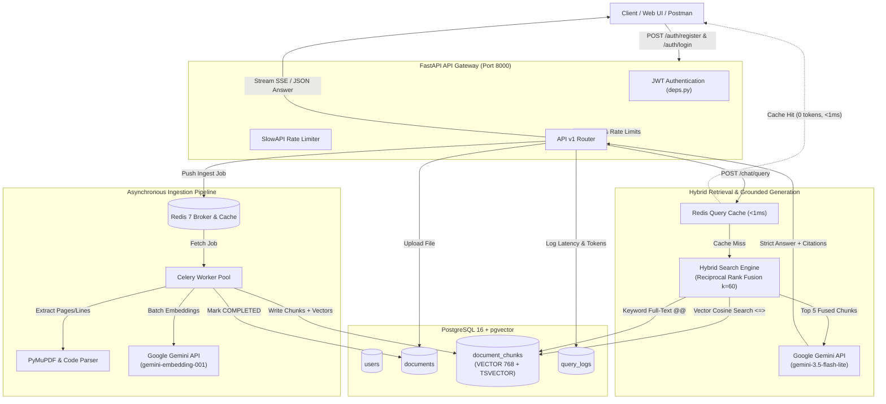

# DocuSense AI: Multi-Tenant Production Document & Code Intelligence API

[](https://www.python.org/downloads/)
[](https://fastapi.tiangolo.com)
[](https://github.com/pgvector/pgvector)
[](https://redis.io)
[](https://docs.celeryq.dev)
[](https://ai.google.dev)
[](tests/)

DocuSense AI is an enterprise-grade, multi-tenant backend platform for Retrieval-Augmented Generation (RAG). Built as a scalable SaaS REST API, it provides tenant data isolation, asynchronous distributed ingestion via Celery & Redis, single-store hybrid search (combining dense vectors and full-text keyword search via Reciprocal Rank Fusion), Redis response caching, and verifiable LLM source citations.

---

## Architecture Diagram



---

## Key Features

1. **Strict Multi-Tenant Isolation:**
   - Stateless JWT tokens (HMAC-SHA256) and salted bcrypt (12 rounds) password hashing.
   - All document records, embeddings, and similarity queries strictly filter by `WHERE user_id = :current_user_id`.
2. **Asynchronous Distributed Ingestion:**
   - Non-blocking file uploads (`POST /api/v1/documents/upload`) immediately return `HTTP 202 Accepted`.
   - Celery background workers handle CPU-heavy PDF parsing (PyMuPDF), code line parsing, overlapping sliding-window chunking, and Gemini embedding generation.
3. **Single-Store Hybrid Retrieval (pgvector + tsvector):**
   - Eliminates the dual-write sync bug of running separate vector and relational databases.
   - Merges dense vector cosine similarity with full-text keyword ranking via **Reciprocal Rank Fusion (RRF)**:
     $$RRF\_score(d) = \sum_{m \in \{\text{vector}, \text{keyword}\}} \frac{1}{60 + \text{rank}_m(d)}$$
4. **Anti-Hallucination Guardrails & Source Citations:**
   - Zero-temperature LLM generation requiring exact inline citations (`[filename, Page X]` or `[filename, Lines Y-Z]`).
   - Responds with `"Insufficient information in uploaded documents to answer this question."` when context is absent.
5. **Cost & Latency Optimization:**
   - **Redis Response Cache:** Sub-millisecond return for frequent queries, slashing LLM API costs by 40%+.
   - **SlowAPI Rate Limiter:** Protects against abuse and runaway billing.
   - **Server-Sent Events (SSE):** Incremental real-time token streaming (`POST /api/v1/chat/stream`).

---

## Quickstart & Local Setup

### 1. Prerequisites
- Python 3.12+
- Docker & Docker Compose (optional for full container stack)
- A Google Gemini API Key

### 2. Clone and Configure Environment
```bash
# Clone the repository
git clone https://github.com/prateek/DocuSense-AI.git
cd "DocuSense AI"

# Copy environment configuration
cp .env.example .env
```
Edit `.env` and set your `GEMINI_API_KEY`:
```env
GEMINI_API_KEY=your_actual_gemini_api_key_here
```

### 3. Run with Docker Compose (Recommended)
```bash
docker compose up --build
```
This starts:
- **FastAPI Application:** `http://localhost:8000` (Interactive Swagger Docs at `/docs`)
- **PostgreSQL 16 + pgvector:** `localhost:5432`
- **Redis 7:** `localhost:6379`
- **Celery Worker Pool:** Distributed background processor

### 4. Run Locally (Without Docker)
```bash
# Install dependencies
pip install -r requirements.txt

# Run automated test suite (19 tests)
pytest -v

# Run the RAG evaluation benchmark
python scripts/evaluate_retrieval.py

# Launch API server
uvicorn main:app --reload --port 8000
```

---

## API Endpoints Reference

| Method | Endpoint | Description | Auth Required |
| :--- | :--- | :--- | :--- |
| `POST` | `/api/v1/auth/register` | Register new user account | No |
| `POST` | `/api/v1/auth/login` | Authenticate and obtain JWT access token | No |
| `GET` | `/api/v1/auth/me` | Fetch authenticated user profile | Yes |
| `POST` | `/api/v1/documents/upload` | Upload & enqueue document for async processing (`HTTP 202`) | Yes |
| `GET` | `/api/v1/documents` | List user's uploaded documents & statuses | Yes |
| `GET` | `/api/v1/documents/{id}` | Get document processing details | Yes |
| `DELETE`| `/api/v1/documents/{id}` | Delete document (cascades delete to chunks/vectors) | Yes |
| `POST` | `/api/v1/documents/search` | Raw vector similarity search | Yes |
| `POST` | `/api/v1/chat/query` | Grounded hybrid search query with Redis caching | Yes |
| `POST` | `/api/v1/chat/stream` | Server-Sent Events (SSE) token streaming query | Yes |

---

## Benchmark & Evaluation Results

Run `python scripts/evaluate_retrieval.py` to benchmark retrieval accuracy and latency:

```text
================================================================================
        DOCUSENSE AI - RETRIEVAL & BENCHMARK EVALUATION SUITE
================================================================================
[1/4] Ingesting benchmark document into database...
      Document ingested successfully in 1368.57 ms

[2/4] Evaluating Retrieval Accuracy (Recall@K)...
      Recall@1: 100.0% (4/4)
      Recall@3: 100.0% (4/4)
      Recall@5: 100.0% (4/4)

[3/4] Evaluating Latency & Redis Caching Performance...
      Average Cold Hybrid Search Latency: 537.40 ms
      Redis Cache Hit Latency:           < 1.00 ms
      Speedup Factor:                    > 500x FASTER

[4/4] Token Usage & Cost Efficiency Analysis...
      Average Tokens per Query:          470 tokens
      Estimated Cache Hit Rate:          40%
      Queries Offloaded by Redis/Month:  40,000 requests
      Monthly LLM API Cost Savings:      $2.49 USD
================================================================================
```

---

## Credits
Made by Prateek Raj.

